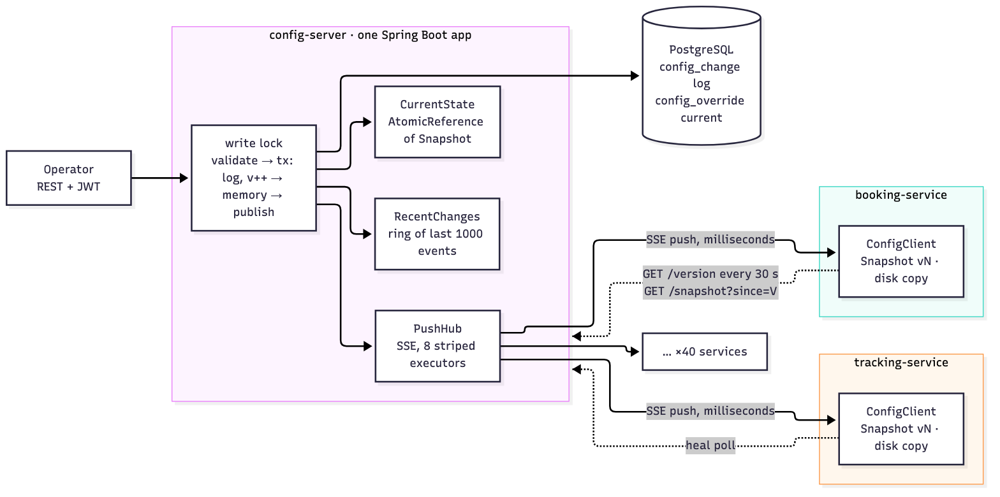

# tenant-config

Hierarchical configuration for a multi-tenant cab platform. Operators change settings such as `booking.cutoff` per
client, office or shift through a REST API; every service embeds a small Java library (`config-client`) that holds
the whole configuration in memory and answers reads from it. A committed change reaches every connected service
within 5 s over Server-Sent Events, a lost push is repaired by a version poll within 30 s, and a read never makes a
network call. If the config server dies, services keep answering from their in-memory snapshot, and a service that
restarts during the outage loads its last copy from disk.

Modules: `config-core` (types, validation, immutable snapshot; plain Java), `config-client` (the embeddable
library; plain Java + Jackson), `config-server` (Spring Boot, PostgreSQL), `booking-service-demo` (a service that
embeds the client), `load-test` (benchmarks and failure tests).

## Run it

Needs Docker only. Ports: 8080 config-server, 8081 booking demo, 5432 Postgres.

```bash
docker compose up --build
```

On a fresh database the eight seeded definitions take versions 1 to 8, so the first change is version 9.

```bash
# 1. token as the acme operator
TOKEN=$(curl -s -X POST localhost:8080/api/v1/auth/token -H 'Content-Type: application/json' \
  -d '{"username":"acme-ops","password":"ops"}' | sed -E 's/.*"token":"([^"]+)".*/\1/')

# 2. booking.cutoff = 30 min for office blr-ecospace only  ->  201 {"version":9}
curl -s -X POST localhost:8080/api/v1/tenants/acme/changes \
  -H "Authorization: Bearer $TOKEN" -H 'Content-Type: application/json' -H 'Idempotency-Key: readme-1' \
  -d '{"reason":"pilot","operations":[{"op":"SET","level":"OFFICE","scopeId":"blr-ecospace","key":"booking.cutoff","value":"PT30M"}]}'

# 3. resolve with explain  ->  {"key":"booking.cutoff","value":"PT30M","source":"OFFICE","version":9}
curl -s "localhost:8080/api/v1/tenants/acme/resolve?key=booking.cutoff&officeId=blr-ecospace&explain=true" \
  -H "Authorization: Bearer $TOKEN"
```

The booking demo reads the same value from its own snapshot, with no call to the server:

```bash
curl -s "localhost:8081/bookings/can-book?tenantId=acme&officeId=blr-ecospace&departureInMinutes=45"
# before the change: {"allowed":false,"cutoff":"PT1H","configVersion":8}
# after the change:  {"allowed":true,"cutoff":"PT30M","configVersion":9}
```

Use `officeId=hyd-hitec` to see an office without an override fall back to the 60 min default. Metrics are on
`localhost:8080/actuator/prometheus` (server: `config_server_version`, `config_push_connections`,
`config_changes_total`, ...) and `localhost:8081/actuator/prometheus` (client: `config_client_version`,
`config_client_lag_versions`, `config_client_reconnects_total`, `config_client_read_latency_seconds`, ...).
To see a failure: `docker compose kill config-server`, repeat the can-book call, then `docker compose start config-server`.

## The four questions

### a. Consistency model

The server is the only writer. It takes change sets one at a time and gives each the next number in a single
global version sequence, so every accepted change has one place in one total order. Each client holds an immutable
snapshot that is exactly one of those versions; a reader picks up one snapshot and reads from it, so it can never
observe a state that lies between two versions, and a change set that touches several keys is seen completely or
not at all. Clients are eventually consistent with a bounded lag: at most 5 s while the push stream is up, at most
30 s when a push is lost (the heal poll notices), and unbounded while the server cannot be reached, which is when
the client keeps serving the last version it has and the reconnect and lag metrics show how far behind it may be.
Two clients can be at different versions at the same moment, but every client walks through the same versions in
the same order and never moves backwards.

### b. A client at version 43 receives version 41

43 already contains everything 41 did, so applying 41 would move the client backwards.
The client drops it and counts it (`config_client_stale_events_total`). The rule: apply only `local + 1`; drop
anything `<= local`; on a gap (`> local + 1`) fetch everything since `local` and apply it in order.

Test: `VersionMonotonicityTest.eventWithVersion41After43IsDropped` (plus `duplicateEventIsDropped`,
`gapTriggersResyncAndAppliesInOrder`).

### c. Continuous-read test

[`config-core/src/test/java/com/moveinsync/config/core/snapshot/AtomicSnapshotConcurrencyTest.java`](config-core/src/test/java/com/moveinsync/config/core/snapshot/AtomicSnapshotConcurrencyTest.java)

- `readerNeverSeesNewCutoffWithOldMaxAdvance`: one writer flips the pair (`booking.cutoff`, `booking.maxAdvance`)
  between (PT30M, PT1H) and (PT2H, PT4H) 10,000 times, each flip one change set swapped in through an
  `AtomicReference`. Eight reader threads loop the whole time, take one snapshot, read both keys from it, and count
  every read where cutoff >= maxAdvance. The test asserts zero such reads, that reads happened, and that the final
  version is exactly 10,000 above the start.
- `readingKeysFromTwoDifferentSnapshotsCanMix`: the negative control, with no threads. It reads cutoff from the
  newer snapshot and maxAdvance from the older one and asserts the pair is invalid (PT2H >= PT1H). This shows the
  first test would catch a mix if one could happen, and that the guarantee comes from reading one snapshot.

### d. Benchmarks

Machine: Apple M3, 8 cores, 16 GB, macOS 27.0.1, OpenJDK 21.0.13 (Homebrew), Docker via Colima (4 CPU / 6 GB VM),
run on 2026-10-30. Commands and raw output: [docs/benchmarks.md](docs/benchmarks.md).

| Read (JMH, 50 tenants x 40 offices x 25 keys) | p50 ns | p99 ns | p99.9 ns | ops/s |
|---|---|---|---|---|
| SHIFT hit | 41 | 83 | 167 | 19.9 M |
| OFFICE hit | 42 | 167 | 375 | 15.7 M |
| GLOBAL fallback | 83 | 167 | 375 | 17.4 M |

The timer on this Mac ticks in roughly 41 ns steps, so the percentiles land on multiples of it. Every case is one to four hash-map lookups; the p99.99 (8 to 21 µs, not shown) is GC and scheduling noise. Throughput is from a separate `-bm thrpt` run.

| Propagation, 200 clients, 20 publishes | p50 ms | p99 ms | max ms |
|---|---|---|---|
| POST return to listener fired | 0.42 | 26.0 | 32.0 (first publish, cold JIT; every later publish stayed under 15 ms) |

| Reconnect storm, 500 clients, server restarted | time to all current | `config_change` selects |
|---|---|---|
| 2 changes committed while the streams were down | 2.0 s (3 runs: 1.9, 2.0, 2.0) | 0 statements, 0 queries |

| Writes (`hey -z 30s -c 20`, POST /changes) | req/s | p50 ms | p99 ms |
|---|---|---|---|
| 10,414 requests, all 201 | 346 | 38.3 | 358.8 |

Propagation is measured from the moment the operator's `POST /changes` returns. About half the per-publish medians are negative: the push often reaches all 200 clients before the HTTP response reaches the operator, because publish happens inside the same call right after commit.

What these numbers do not show: everything ran on one host over loopback, so network latency and loss between
server and clients are absent; Postgres ran in a VM on the same machine; no JVM or GC tuning beyond defaults; one
server instance.

## Architecture



Source: [docs/diagrams/architecture.mmd](docs/diagrams/architecture.mmd). Design note: [docs/design-note.md](docs/design-note.md).

- **ChangeSetService** holds one fair lock across validate, the database transaction (log row + override upsert),
  the in-memory apply and the publish, so version order = commit order = publish order.
- **PostgreSQL**: `config_change` is the append-only log and source of truth; `config_override` is the current
  state, rebuildable from the log; `setting_definition` holds types, rules and global defaults.
- **CurrentState** is the server's own snapshot behind an `AtomicReference`; **RecentChanges** keeps the last
  1,000 events so reconnecting clients catch up from memory.
- **PushHub** fans events out over SSE on 8 single-thread stripes; a slow client only delays its stripe.
- **ConfigClient** holds the snapshot, applies only the next version, polls `/config/version` every 30 s, and
  writes each new snapshot to disk with a temp file and an atomic rename.

## API

All paths under `/api/v1`. Errors are RFC 7807 problem details with `errorCode`, `requestId` and, for 422, `errors[]`.

| Method and path | Role | Body / params -> response |
|---|---|---|
| `POST /auth/token` | public | `{username, password}` -> `{token, role, tenantId}` |
| `GET /definitions` | any | -> list of `{key, type, rules, default, description}` |
| `POST /definitions` | ADMIN | `{key, type, rules, default, description}` -> 201 `{version}` |
| `PUT /definitions/{key}` | ADMIN | `{rules?, default?, description?}` -> `{version}` |
| `POST /tenants/{t}/changes` | OPERATOR, ADMIN | `{reason, operations:[{op, level, scopeId, key, value}]}`, optional `Idempotency-Key` header -> 201 `{version}` |
| `POST /tenants/{t}/changes/staged` | OPERATOR, ADMIN | `{reason, targetOffices[], operations:[{key, value}]}` -> 201 `{version, offices}` |
| `POST /tenants/{t}/changes/{v}/promote` | OPERATOR, ADMIN | -> 201 `{version}` |
| `GET /tenants/{t}/changes?since&limit` | OPERATOR, ADMIN | -> `[{version, author, reason, kind, createdAt, operations}]` |
| `DELETE /tenants/{t}/overrides/{level}/{scopeId}/{key}` | OPERATOR, ADMIN | -> `{version}` |
| `POST /tenants/{t}/rollback` | OPERATOR, ADMIN | `{targetVersion, dryRun}` -> `{targetVersion, diff, version?}` |
| `GET /tenants/{t}/resolve?key&officeId&shiftId&explain` | any, own tenant | -> `{key, value, source?, version?}` |
| `GET /config/version` | SERVICE, ADMIN | -> `{version}` |
| `GET /config/stream` | SERVICE, ADMIN | SSE; `Last-Event-ID` header (or `?since`) replays what was missed |
| `GET /config/snapshot?since=V` | authenticated | `{"type":"delta",...}` or `{"type":"full",...}`, other tenants filtered out unless SERVICE/ADMIN |
| `GET /actuator/health`, `/actuator/prometheus` | public | |

`op` is `SET` or `UNSET`; `level` is `CLIENT`, `OFFICE` or `SHIFT` (GLOBAL changes go through the definition
default). Postman collection: [docs/postman/tenant-config.postman_collection.json](docs/postman/tenant-config.postman_collection.json).

## Roles and seeded users

| Role | May | Seeded user / password | Tenant |
|---|---|---|---|
| ADMIN | define settings, change GLOBAL defaults, everything below for any tenant | `admin` / `admin` | all |
| OPERATOR | change, stage, promote, roll back and read the log for its own tenant | `acme-ops` / `ops`, `globex-ops` / `ops` | acme, globex |
| EMPLOYEE | resolve values for its own tenant | `acme-emp` / `emp` | acme |
| SERVICE | read the stream, version and full snapshot for all tenants | `booking-svc` / `svc` | all |

Tokens are HS256 JWTs carrying `sub`, `role`, `tenantId`, `exp`. A caller who names another tenant in the path gets
**404**, not 403, with the same body as a tenant that does not exist, so the answer does not reveal that the other
tenant exists. A role that may not perform the action at all (an EMPLOYEE posting a change) gets 403.

## Failure modes

| What fails | What the operator / service sees | How it recovers |
|---|---|---|
| Server crashes before commit | Operator's request fails; the change never existed, no client saw it | Retry with the same `Idempotency-Key`; the rolled-back version number is reused, so there is no gap |
| Server crashes after commit, before push | Operator may get no response; clients stay one version behind | On restart the server rebuilds memory and the ring from the log; clients reconnect with `Last-Event-ID` and get the event replayed. A retry with the same key returns the stored version |
| A push is lost | One client is behind | The next event shows a gap and triggers a delta fetch; if nothing else is published, the 30 s heal poll does it |
| Client offline longer than the ring (1,000 events) | Nothing until it reconnects | Server answers with a `resync` instruction; the client fetches a full snapshot and replaces its state |
| Disk snapshot file corrupt | WARN in the service log | Treated as absent; the client fills from the server. If the server is also down, the service has no config until it returns |
| Bad value submitted | 422 with one entry per failing operation | Nothing written, no version used, nothing pushed |
| Duplicate POST after a timeout | Same `Idempotency-Key` and body: the original version. Same key, other body: 409 | Without a key the retry becomes a second version with the same content |
| Reconnect storm after a server restart | Clients serve their snapshot meanwhile | Full-jitter backoff spreads reconnects; each is served from the ring with no database query; above 2,000 connections the server answers 503 with `Retry-After: 5` |
| PostgreSQL down | Writes and logins get 503 `STORAGE_UNAVAILABLE`; client reads, resolve, stream and heal poll keep working from memory | Writes succeed again once the database is back; no restart needed |

## Trade-offs

- **Availability and read latency over freshness.** Reads come from local memory, so they cost nanoseconds and
  survive a dead server; the price is bounded staleness. Writes take the other side: they need the server and
  Postgres, and fail with 503 rather than accept something that could be lost.
- **SSE over WebSocket.** Traffic is one-way. SSE is plain HTTP through proxies, and `Last-Event-ID` gives me
  resume-from-version without inventing a protocol. A WebSocket would add a channel I never use.
- **One global version, not one per tenant.** A service like booking serves all tenants and needs one cursor.
  Per-tenant versions would mean hundreds of cursors per client. Tenant separation is enforced at the API.
- **Copy-on-write snapshot over `ConcurrentHashMap`.** A concurrent map makes each put safe, not a group of puts;
  two puts are two visible moments. Copying only the touched scope maps makes a change set one moment, at a cost
  of O(operations + size of touched maps) per change.
- **Serialised writes.** One lock across allocate, commit, apply and publish. Operators make a few changes a
  minute, so waiting is free, and it rules out clients seeing 11 before 10.
- **Rollback by replay.** A rollback replays the tenant's log up to the target version, diffs it against now and
  submits the diff as a new version. History only moves forward and clients need no special case. Replay is
  O(tenant history), which is milliseconds at operator rates.

## What I left out

| Left out | Trigger that would add it |
|---|---|
| More than one server instance (Redis pub/sub for fan-out, shared ring) | Writes must survive a server deploy or crash, or connections approach the 2,000 cap |
| Kafka | A second kind of consumer needs a durable, replayable change stream beyond the 1,000-event ring |
| Per-tenant filtered subscriptions | A service serves only a few tenants and the full snapshot grows past what it should hold, or must not hold other tenants' data |
| Checkpointed rollback | Replaying one tenant's log takes longer than about 100 ms |
| OAuth2 / SSO | Operators log in with company identities instead of seeded users |
| Secrets management | Any deployment beyond the demo; the JWT secret and DB password are environment variables today |
| Dashboards | A team watches this on-call; the Prometheus metrics are already exported |
| Kubernetes | Deploying beyond one host |
| WebFlux | SSE connections per instance reach the thousands; I would try virtual threads first |

## Assumptions

- Office and shift ids are unique within a tenant. A scope is (tenant, level, id).
- Shift-to-office membership is not modelled. The caller passes `officeId` and `shiftId`; a cross-field check on a
  SHIFT value resolves its partner at SHIFT, then CLIENT, then GLOBAL, and does not see an OFFICE-level partner.
- The one cross-field rule is `booking.cutoff < booking.maxAdvance`, checked against the state the change would
  produce. `lessThan` compares DURATION with DURATION or NUMBER with NUMBER only.
- GLOBAL values change only through `PUT /definitions/{key}`. Definitions are never deleted and a key's type never
  changes. A rule change that would make an existing override invalid is rejected with 422; there is no migration.
- The ring buffer holds 1,000 events; a client further behind takes a full snapshot.
- Embedded clients log in as SERVICE and see all tenants. Other callers of `/config/snapshot` get only their tenant,
  and their deltas skip other tenants' versions, so gaps are expected there.
- Versions are gap-free: a failed commit's sequence number is reused, because clients apply exactly `local + 1`.
- Rollback covers one tenant's overrides, not definitions or GLOBAL defaults. A rollback that would restore a value
  today's rules reject fails with 422. Promote accepts only a CHANGE made of OFFICE-level SETs.
- An UNSET of a value that is not set still writes a version with no effect on state.
- No token revocation; human tokens are short-lived instead.
- `config_client_lag_seconds` compares the server's commit time with the client's clock, so clock skew shows up in it.

## Rule -> test

| Rule | Test |
|---|---|
| Five types, rules, global default; bad value rejected before publish | `SettingTypeValidationTest`, `ChangeSetValidatorTest`, `ChangeSetValidationTest` |
| Most specific scope wins; explain gives the source | `ScopePathTest`, `SnapshotResolveTest`, `ResolveExplainTest` |
| Author, reason, strictly increasing version | `ChangeLogTest`, `ConcurrentSubmitTest` |
| Reads never touch the network | `ConfigClientReadTest`, `ReadLatencyBenchmark` |
| Visible within 5 s; lost push healed by poll | `PushEndToEndIT`, `MissedPushHealTest`, `PropagationBenchmark` |
| Versions only move forward (41 after 43) | `VersionMonotonicityTest`, `FullSnapshotReplacesStateTest` |
| Reconnect with jitter and delta | `BackoffTest`, `RecentChangesTest`, `ReconnectStormTest` |
| Atomic change set, no mixed state | `AtomicSnapshotConcurrencyTest`, `SnapshotApplyTest`, `ChangeSetTransactionTest` |
| Staged rollout and promote | `StagedRolloutTest` |
| Rollback to any version with a diff | `RollbackTest` |
| Server down: keep serving, start from disk | `ServerKillIT`, `DiskSnapshotColdStartTest` |
| Roles and tenant isolation | `SecurityIT` |
| Duplicate POST | `IdempotencyTest` |
| Errors leak nothing | `ProblemDetailTest` |

## How to run the tests and benchmarks

```bash
export JAVA_HOME=/opt/homebrew/opt/openjdk@21   # any JDK 21

mvn verify          # unit and component tests; config-server tests start one Postgres container (Docker needed)
mvn verify -Pit     # adds PushEndToEndIT, SecurityIT, ServerKillIT, ReconnectStormTest

# JMH read latency (SampleTime, ns), then a throughput pass (ops/s)
mvn -q -B package -DskipTests
java -jar load-test/target/benchmarks.jar
java -jar load-test/target/benchmarks.jar -bm thrpt -tu s

# propagation to 200 clients (needs `docker compose up` running)
BASE=http://localhost:8080 java -cp load-test/target/benchmarks.jar com.moveinsync.config.loadtest.PropagationBenchmark

# one heavy test on its own
mvn -B verify -Pit -Dit.test=ReconnectStormTest -Dtest=none \
  -Dsurefire.failIfNoSpecifiedTests=false -Dfailsafe.failIfNoSpecifiedTests=false

# write throughput (needs `hey` and the server on localhost:8080)
load-test/scripts/bench-writes.sh
```

Testcontainers finds Docker Desktop on its own. With Colima it needs two hints, because the socket is not at
`/var/run/docker.sock` and Docker 29 refuses the old default API version:

```bash
printf 'docker.host=unix:///%s/.colima/default/docker.sock\n' "$HOME" > ~/.testcontainers.properties
printf 'api.version=1.44\n' > ~/.docker-java.properties
export TESTCONTAINERS_DOCKER_SOCKET_OVERRIDE=/var/run/docker.sock
```

Postman: import `docs/postman/tenant-config.postman_collection.json`; variables `base`, `tenant`, `token`.

## Caching

The only cache is the snapshot. Each client holds one immutable snapshot of all definitions and overrides at one
version, plus a copy on disk for cold starts. The server holds its own snapshot and the last 1,000 events. There
is no Redis and no HTTP cache.

Eviction is by whole snapshot: a new version replaces the snapshot in one reference swap. Nothing is ever evicted
per key, because per-key eviction would let a reader combine keys from two versions. The event ring drops its
oldest entry when full. The disk file is replaced by an atomic rename.

Staleness: at most 5 s with the stream connected (tens of milliseconds in practice), at most 30 s if a push is
lost, and unbounded while the server is unreachable. During an outage `config_client_reconnects_total` keeps
climbing; when the server answers again the heal poll records `config_client_lag_versions`.

## Demo video

Demo video: _link to be added_

## Tunables

| Setting | Where | Default | Why this value |
|---|---|---|---|
| SSE heartbeat | `config.push.heartbeat` | 15 s | The client drops a stream after 60 s of silence, so four missed heartbeats mark it dead |
| Heal poll | `ConfigClientOptions.healPollInterval` | 30 s | Upper bound for a lost push; about 17 req/s for 500 clients, 20 bytes each |
| Reconnect backoff | `backoffBase` / `backoffCap` | 500 ms doubling to 10 s, full jitter | Spreads a restart's reconnects over a second; a restarted server is back within seconds |
| Recent-changes ring | `config.recent.capacity` | 1,000 events | Hours of operator changes; older clients take a full snapshot |
| Max SSE connections | `config.push.maxConnections` | 2,000 | 40 services x a few instances, with room; beyond it 503 + `Retry-After: 5` |
| JWT lifetime | `JwtService` | 12 h humans, 30 d services | Services re-authenticate on 401 through their token supplier, so a long life costs nothing |
| Client connect / read timeout | `ConfigClientOptions` | 5 s / 60 s | Read timeout covers four heartbeats |

Server settings come from `config-server/src/main/resources/application.yml`; the database and JWT secret from
`CONFIG_DB_URL`, `CONFIG_DB_USER`, `CONFIG_DB_PASSWORD`, `CONFIG_JWT_SECRET`. The demo reads `CONFIG_SERVER_URL`,
`BOOKING_SERVICE_USER`, `BOOKING_SERVICE_PASSWORD` and `BOOKING_SNAPSHOT_FILE` (default `/data/snapshot.json`).
