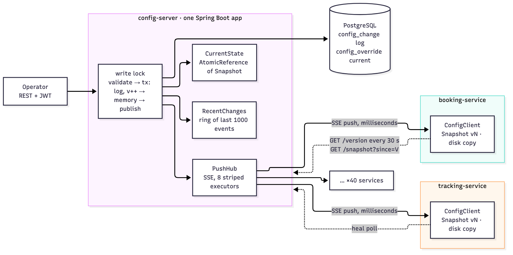
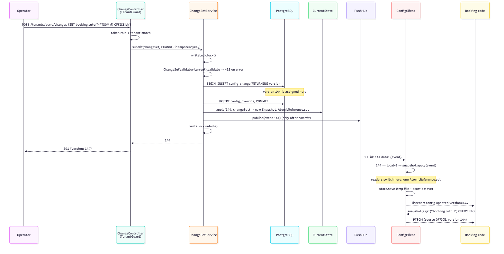

# Design note: tenant-config

## Problem

About 40 services read per-tenant settings such as `booking.cutoff` on almost every request, and each setting can be
set at GLOBAL, CLIENT, OFFICE or SHIFT level, where the most specific level wins. A change must reach all of those
services within 5 seconds, and a group of related changes must never be seen half-applied. The services must keep
working when the config server is down, so they cannot ask it on every request.

## Architecture

Source: [diagrams/architecture.mmd](diagrams/architecture.mmd)

One Spring Boot server is the only writer. It checks each change set and stores it as one row in an append-only log
(rows are only added, never changed) in PostgreSQL, with the next global version number. It then updates its
in-memory snapshot and pushes the event to every connected client over Server-Sent Events (SSE: one long HTTP
response that the server keeps writing to).

Each service embeds `config-client`. The client keeps an immutable snapshot (a read-only copy of all settings at one
version) in memory and applies events strictly in version order. Every 30 s it also polls the server's version to
catch anything the push missed; I call this the heal poll. It saves each snapshot to disk, so it can start while the
server is down.

## Publish sequence

Source: [diagrams/sequence-publish.mmd](diagrams/sequence-publish.mmd)

1. The operator posts a change. `@PreAuthorize` checks the role and `TenantGuard` checks the tenant.
2. `ChangeSetService.submit` takes the write lock and checks every operation against the current snapshot.
3. In one transaction it inserts the `config_change` row. **The version is assigned here**, by the database
   sequence, inside the lock. Then it upserts (inserts or updates) the override rows and commits the transaction.
4. Only after the commit, `CurrentState.apply` builds the server's next snapshot. The event goes into the
   1,000-entry ring (a fixed-size buffer of recent events, kept for replay), and `PushHub.publish` queues it on each
   connection's stripe (the single sending thread that the connection is assigned to). Then the lock is released.
5. The client receives `id: 144`. Because 144 = local + 1, it builds a new snapshot from the old one plus the change.
   **Readers switch here**, in one reference assignment. Then the snapshot is written to disk (temp file + atomic
   rename) and listeners are notified.
6. Booking code calls `client.snapshot()` or `client.explain(...)` and gets `PT30M` (30 minutes), source OFFICE,
   version 144, from memory.

## Consistency

All writes go through one server, and that server puts every change set into a single global version sequence. Each
client holds an immutable snapshot that matches exactly one version, and each reader reads from one snapshot. So no
reader sees a state between two versions, and a multi-key change is all-or-nothing. Clients are eventually
consistent: they catch up after a short delay. The staleness bound (how far behind a client can be) is 5 s while
pushes arrive and 30 s when a push is lost. While the server is unreachable there is no bound. The client keeps
serving its last version, and the metrics show this. Clients can be at different versions for a short time, but each
one passes through the same versions in the same order and never goes back. The one exception is when the server's
database is restored to an older version. Then the clients follow it back.

## Failure modes

| What fails | What is seen | Recovery |
|---|---|---|
| Server crash before commit | The request fails; no version is created | Retry with the same `Idempotency-Key` (a request id sent by the caller); the sequence number is reused |
| Server crash after commit, before push | Clients are one version behind | On restart the server rebuilds its state and ring from the log; clients catch up by `Last-Event-ID` replay or the heal poll |
| Push lost | One client is behind | A gap on the next event, or the 30 s heal poll, triggers a delta fetch (only the missing changes) |
| Client offline for more than 1,000 events | Nothing until it reconnects | A `resync` instruction; a full snapshot replaces the local state |
| Disk file corrupt | A WARN log line | Treated as missing; filled from the server |
| Bad value | 422 with `errors[]` | Nothing is written or pushed |
| Duplicate POST | The original version, or 409 if the body differs | Idempotency key, kept per tenant |
| Reconnect storm | Clients keep serving | Full-jitter backoff (each client waits a random time before reconnecting), ring replay with zero DB reads, 503 + `Retry-After` above 2,000 connections |
| PostgreSQL down | Writes and logins get 503 | Reads are not affected; writes resume when the database is back |
| Commit acknowledgement lost | The operator sees an error; the server's memory is one version behind | The next write first reloads state from the database |
| Definition change would break `cutoff < maxAdvance` | 422 `CROSS_FIELD_ORDER` naming the scope | Nothing is written; change the overrides first |
| Promoting a staged change after newer changes overtook it | 409 `STAGED_CHANGE_SUPERSEDED` | Nothing is written; stage it again |

## Trade-offs

- I chose read availability and latency over freshness. Reads are local and keep working when the server is dead.
  Staleness is bounded and measured. Writes need the server and the database, and when either is missing they fail
  loudly instead.
- SSE, not WebSocket: the traffic is one-way, it is plain HTTP, and `Last-Event-ID` gives resume-from-version for
  free.
- One global version: a consumer that serves all tenants needs one cursor (its last seen version), not hundreds.
- Copy-on-write snapshot (each change builds a new copy instead of editing the old one): a change set becomes
  visible at one moment. The cost is copying the scope maps that the change touches.
- Serialised writes (one at a time, under the lock): at a few changes a minute the lock costs nothing, and it keeps
  version order, commit order and publish order identical.
- Rollback by replaying the tenant's log: simple and exact. Its cost is O(history), which is milliseconds at
  operator rates.

## Left out

I left out more than one server instance (Redis pub/sub), Kafka, per-tenant filtered subscriptions, checkpointed
rollback, OAuth2/SSO, secrets management, dashboards, Kubernetes and WebFlux. The README lists what would make each
one worth adding.

## Assumptions

Office and shift ids are unique within a tenant. Shift-to-office membership is not modelled, so a cross-field check
on a SHIFT value does not see the related value at OFFICE level. If a rollback would restore a value that the current
rules reject, it fails with 422 instead of succeeding. A rollback request without `"dryRun": false` is only a
preview. The embedded client authenticates as SERVICE and sees every tenant. `config_client_lag_seconds` is the time
since the server last proved it is alive (it sends a heartbeat every 15 s), so the value stays under 15 s while the
client is connected. A restored database is noticed when its version falls below a client's version. The client then
takes the server's full snapshot.

## Why not the obvious way

- **Call the server on every request.** 40 services times every request is a lot of traffic for values that change
  a few times a minute. Every read would also depend on one server being up. A local snapshot answers in
  nanoseconds and works whether the server is alive or not.
- **`ConcurrentHashMap` on the client.** It makes each put thread-safe. But a change set of two keys is still two
  puts, and a reader can land between them. That reader would see a new cutoff with an old maxAdvance, and that
  combination blocks every booking. An immutable snapshot swapped in with one assignment has no in-between state.
- **WebSocket for push.** Here the server talks and the client only listens. Nothing flows back. WebSocket needs an
  upgrade step that some proxies handle badly, and it has no built-in resume point. When SSE reconnects it sends
  `Last-Event-ID`, which is exactly the "I was at 143" that the delta catch-up needs.
- **A version counter per tenant.** The booking service serves every tenant, so it would track hundreds of cursors
  and the server would keep hundreds of streams. Keeping tenants apart is an authorisation question. It is handled
  at the API by `TenantGuard`, not by the counter.
- **A plain thread pool for fan-out.** Fan-out here means sending each event to every connection. Two events for the
  same connection could run on two threads and arrive as 145 before 144. The client would treat that as a gap and resync.
  `SseEmitter.send` also blocks, so one slow client could tie up the pool. Eight single-thread stripes, with each
  connection pinned to one, keep the order per connection and limit a slow client to its own stripe.
